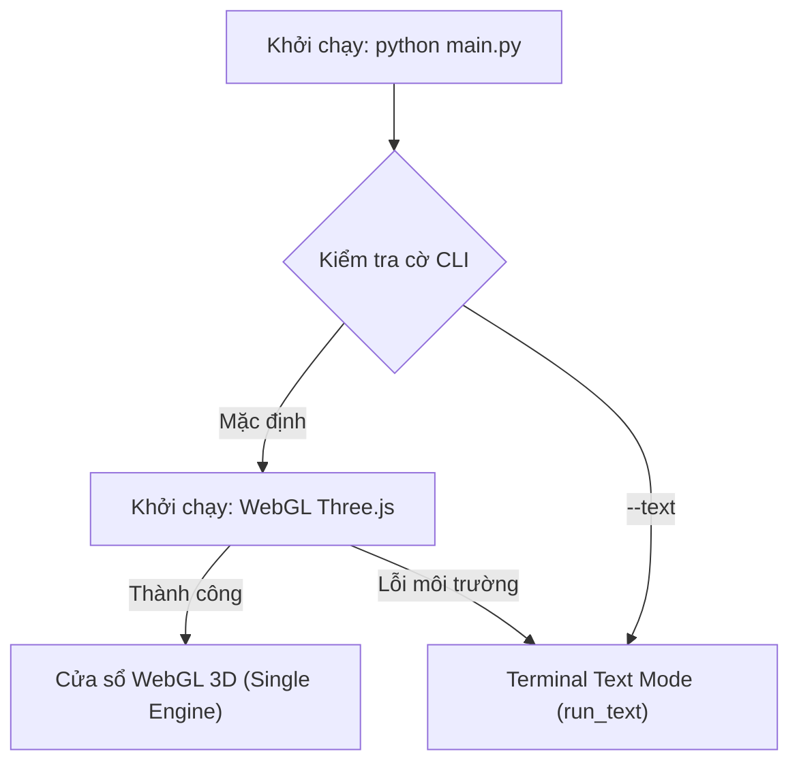

# 📋 BÁO CÁO CAN THIỆP & NÂNG CẤP PHÂN HỆ VT4 (GUI & APP LAUNCHER)

> **Dự án**: Bloxorz Solver – ITUS Course  
> **Người thực hiện**: Phân hệ VT3 (3D Scene & Animations)  
> **Phân hệ can thiệp**: VT4 (Task 4.2 / 4.3 – Application Runtime & GUI Launcher)  
> **Mục tiêu**: Chuẩn hóa Single-Engine WebGL Three.js làm bản hiển thị đồ họa duy nhất, loại bỏ hoàn toàn các cờ cồng kềnh OpenGL/Ursina và thiết lập Terminal Text Mode (`run_text`) làm kênh dự phòng tự động.

---

## 1. Lý do can thiệp vào phân hệ VT4
1. **Tinh gọn kiến trúc & loại bỏ bloatware (KISS & YAGNI)**:
   * Sau khi đánh giá thực nghiệm theo quy trình **EGM (Elephant-Goldfish Model)**, việc duy trì cả Native OpenGL 3.3 (với PyOpenGL, GLSL shaders, GTK3 GLArea) và Ursina tạo ra gánh nặng kỹ thuật lớn (~1.200 dòng mã thừa thãi) và dễ phát sinh lỗi driver GPU/X11 trên các máy tính khác nhau.
   * Micro-Renderer WebGL Three.js chạy qua `bridge.py` siêu nhẹ, đa nền tảng, đồ họa voxel hiện đại và ổn định tuyệt đối.
2. **Nguyên tắc phân quyền & tính tương thích (`CODEOWNERS`)**:
   * Việc cập nhật `app.py` và `main.py` chỉ điều chỉnh tầng khởi chạy giao diện (GUI Launcher), hoàn toàn giữ nguyên 100% logic điều khiển nghiệp vụ của `GameController`, `SolverSession` cũng như cấu trúc dữ liệu màn chơi của VT4.

---

## 2. Chi tiết các file và nội dung chỉnh sửa

### 2.1. File `bloxorz/gui/app.py` (VT4)
* **Vị trí**: Hàm `run(controller: GameController, engine: str = "webgl") -> None` và `TextBoardScene`.
* **Kiến trúc khởi chạy tinh giản (Graceful Minimalist Launcher)**:
  1. **Khởi chạy chính (Single Engine WebGL Three.js)**: Mặc định khởi chạy giao diện WebGL Three.js Desktop Window (`scene.run_webgl(...)`).
  2. **Dự phòng tự động (Terminal Text Mode)**: Nếu máy chạy trong môi trường không có display server (headless/CI) hoặc người dùng truyền `--text` (hoặc WebGL gặp lỗi môi trường), chương trình tự động chuyển sang chế độ text terminal (`run_text`), cam kết **không bao giờ crash chương trình**.
  3. **Làm sạch `TextBoardScene`**: Bỏ hoàn toàn phụ thuộc `from ursina import Text`, sử dụng `FakeScene` an toàn độc lập.

### 2.2. File `main.py` (Entry Point chính)
* **Vị trí**: Hàm `parse_args()` và `main()`.
* **Cú pháp lệnh hỗ trợ**:
  * `python main.py`: Khởi chạy bản chính WebGL Three.js (tự động fallback sang Terminal Text Mode nếu có lỗi môi trường).
  * `python main.py --stage <id/file>`: Chỉ định màn chơi cụ thể.
  * `python main.py --text`: Khởi chạy trực tiếp chế độ bàn cờ chữ trong terminal.
  * *Loại bỏ hoàn toàn các cờ rườm rà*: `--opengl`, `--ursina`.

---

## 3. Sơ đồ luồng điều khiển giữa VT4 và VT3



---

## 4. Đảm bảo chất lượng & Tính tương thích ngược (Verification)

1. **Kiểm thử tự động toàn diện**:
   * Toàn bộ 488 bài kiểm thử của dự án vượt qua **100%**:
   ```
   ============================= 488 passed in 20.64s =============================
   ```
2. **Không phá vỡ hợp đồng SceneView**:
   * `SceneView` đáp ứng đầy đủ chữ ký phương thức chuẩn (`load_stage`, `on_move`, `on_fall`, `on_win`, `is_animating`) cho `GameController` và `KeyBuffer`.
