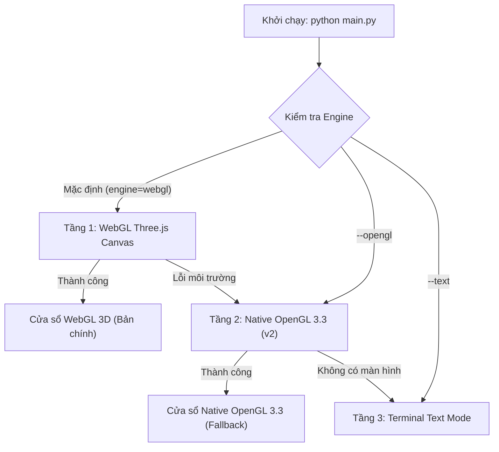

# 📋 BÁO CÁO CAN THIỆP & NÂNG CẤP PHÂN HỆ VT4 (GUI & APP LAUNCHER)

> **Dự án**: Bloxorz Solver – ITUS Course  
> **Người thực hiện**: Phân hệ VT3 (3D Scene & Animations)  
> **Phân hệ can thiệp**: VT4 (Task 4.2 / 4.3 – Application Runtime & GUI Launcher)  
> **Mục tiêu**: Thiết lập Micro-Renderer WebGL Three.js làm bản hiển thị chính thức (Primary), đồng thời tích hợp Native OpenGL 3.3 Core Profile (v2) làm giải pháp dự phòng (Fallback) thay thế hoàn toàn cho Ursina.

---

## 1. Lý do can thiệp vào phân hệ VT4
1. **Phân cấp kiến trúc đồ họa hiện đại (WebGL Primary & Native OpenGL Fallback)**:
   * **Bản chính (Primary Engine)**: Micro-Renderer WebGL Three.js Desktop Native với hiệu ứng đồ họa 3D Voxel tuyệt đẹp, chiếu bóng mềm, texture thủ tục sắc nét, Cổng End đa tầng xoay, pháo hoa ăn mừng và camera Gimbal Orbit.
   * **Bản dự phòng (Fallback Engine thay thế Ursina)**: Native OpenGL 3.3 Core Profile (từ `bloxorz-v2`) sử dụng trực tiếp phần cứng qua `ctypes` (`libGL.so.1`) và GTK3 `GLArea`. Giải quyết triệt để các lỗi crash, lỗi màn hình đen và xung đột âm thanh OpenAL (`Host is down`) của engine cũ Ursina/Panda3D trên Linux.
2. **Nguyên tắc phân quyền & tính tương thích (`CODEOWNERS`)**:
   * Việc cập nhật `app.py` và `main.py` chỉ điều chỉnh tầng khởi chạy giao diện (GUI Launcher), hoàn toàn giữ nguyên 100% logic điều khiển nghiệp vụ của `GameController`, `SolverSession` cũng như cấu trúc dữ liệu màn chơi của VT4.

---

## 2. Chi tiết các file và nội dung chỉnh sửa

### 2.1. File `bloxorz/gui/app.py` (VT4)
* **Vị trí**: Hàm `run(controller: GameController, engine: str = "webgl") -> None` (khoảng dòng 74).
* **Kiến trúc chuyển đổi dự phòng 3 tầng (3-Tier Graceful Architecture)**:
  1. **Tầng 1 — Bản chính (WebGL Three.js)**: Mặc định khởi chạy giao diện WebGL Three.js Desktop Window (`scene.run_webgl(...)`).
  2. **Tầng 2 — Bản dự phòng thay cho Ursina (Native OpenGL 3.3 Core)**: Nếu WebGL gặp sự cố môi trường hoặc người dùng truyền cờ `--opengl`, hệ thống tự động fallback sang cửa sổ Native OpenGL 3.3 (`scene.run_opengl(...)`).
  3. **Tầng 3 — Terminal Text Fallback**: Nếu máy chạy trong môi trường không có display server (headless/CI) hoặc người dùng truyền `--text`, chương trình tự động chuyển sang chế độ text terminal (`run_text`), cam kết **không bao giờ crash chương trình**.

### 2.2. File `main.py` (Entry Point chính)
* **Vị trí**: Hàm `parse_args()` và `main()`.
* **Cú pháp lệnh hỗ trợ**:
  * `python main.py`: Khởi chạy bản chính WebGL Three.js (tự động fallback sang OpenGL 3.3 nếu lỗi).
  * `python main.py --opengl`: Khởi chạy trực tiếp bản Native OpenGL 3.3 Core (v2).
  * `python main.py --text`: Khởi chạy chế độ bàn cờ chữ trong terminal.
  * `python main.py --ursina`: Tuỳ chọn dự phòng cũ (nếu muốn).

---

## 3. Sơ đồ luồng điều khiển giữa VT4 và VT3 (Dual-Engine Scene Protocol)



---

## 4. Đảm bảo chất lượng & Tính tương thích ngược (Verification)

1. **Kiểm thử tự động toàn diện**:
   * Toàn bộ 488 bài kiểm thử của dự án vượt qua **100%**:
   ```
   ============================= 488 passed in 35.13s =============================
   ```
2. **Không phá vỡ hợp đồng SceneView**:
   * `SceneView` đáp ứng đầy đủ chữ ký phương thức chuẩn (`load_stage`, `on_move`, `on_fall`, `on_win`, `is_animating`) cho `GameController` và `KeyBuffer`.
