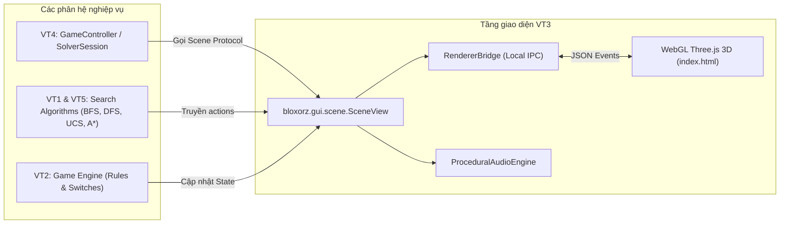

# 📘 HƯỚNG DẪN TÍCH HỢP & PHÁT TRIỂN TRÊN NỀN ĐỒ HỌA 3D VT3

> **Học phần**: CSC14003 – Cơ sở Trí tuệ Nhân tạo (FIT – HCMUS)  
> **Dự án**: Bloxorz AI Solver  
> **Tác giả tài liệu**: Phân hệ **VT3** (Cảnh 3D, Diễn hoạt & Hiệu ứng đồ họa)  
> **Đối tượng áp dụng**:
> - **VT4** (Khang): Điều phối ứng dụng, GUI Controller & Solver Runner.
> - **VT1** (Khoa): Thuật toán tìm kiếm cơ bản (BFS, DFS).
> - **VT5** (Long): Thuật toán tìm kiếm thông tin (UCS, A*, Heuristics) & Benchmarks.
> - **VT2** (Hợp): Luật chơi, tương tác công tắc, cầu lật & khối phân tách.

---

## 1. Tổng quan Kiến trúc Đồ họa VT3

Phân hệ VT3 đã chuẩn hóa kiến trúc sang **Single-Engine WebGL Three.js Micro-Renderer** với tiêu chí **KISS & YAGNI**:
* **Không cồng kềnh**: Đã loại bỏ hoàn toàn mã nguồn cấp thấp OpenGL 3.3 và Ursina (~3.000 dòng code thừa).
* **Đa nền tảng & Ổn định**: Khởi chạy mượt mà trên Desktop (qua `pywebview` / GTK-WebKit2) hoặc bất kỳ trình duyệt hiện đại nào thông qua Local IPC Bridge siêu nhẹ trên cổng ngẫu nhiên (`ephemeral port`).
* **Kênh dự phòng tối hậu**: Tự động chuyển đổi sang Terminal Text Mode (`run_text`) khi phát hiện môi trường không có giao diện đồ họa (Headless CI/CD / SSH Server) hoặc khi người dùng truyền cờ `--text`.



---

## 2. Hướng dẫn dành cho VT4 (Controller & GUI Launcher)

### 2.1. Khởi tạo và liên kết Controller với `SceneView`
Trong `bloxorz/gui/app.py`, VT4 chỉ cần khởi tạo `SceneView` và gọi `bind_controller`:

```python
from bloxorz.gui.scene.view import SceneView

scene = SceneView()
scene.bind_controller(controller)
scene.load_stage(controller.stage, controller.state)
scene.run_webgl()
```

### 2.2. Hợp đồng Giao tiếp 5 Phương thức (Scene Protocol Contract)
VT3 cam kết thực thi đúng 100% hợp đồng `Scene Protocol` mà VT4 yêu cầu:

1. **`scene.load_stage(stage, state=None)`**:
   * Nạp cấu hình màn chơi, dựng lại sàn đá Voxel, đặt khối tại ô xuất phát và đồng bộ số bước đi `moves = 0`.
2. **`scene.on_move(old_state, action, new_state)`**:
   * Diễn hoạt khối gỗ lăn lật bám sàn theo cung tròn toán học.
   * Hỗ trợ tự động cả trạng thái khối nguyên `1x1x2` lẫn khi khối phân tách thành 2 cube `1x1x1`.
   * Tự động phát âm thanh bước chân hoặc âm thanh bật công tắc Redstone.
3. **`scene.on_fall(old_state, action)`**:
   * Diễn hoạt khối mất thăng bằng rơi vào vực sâu hư không hoặc vỡ gạch cát mềm `F`.
   * Kích hoạt hiệu ứng rung máy quay và âm thanh gió rít trầm.
4. **`scene.on_win(state)`**:
   * Khối gỗ hạ xuống giếng không gian Cổng End xoay đa tầng.
   * Bắn pháo hoa hạt 3D và phát chuỗi hợp âm chiến thắng.
5. **`scene.is_animating() -> bool`**:
   * Trả về `True` nếu cảnh đang bận diễn hoạt lật khối hoặc rơi. `KeyBuffer` của VT4 dùng hàm này để ngăn người chơi bấm phím dồn dập gây sai lệch trạng thái.

### 2.3. Bắt và xử lý sự kiện người chơi từ WebGL về Python
`SceneView` đã tích hợp sẵn cơ chế nhận các sự kiện sau từ người chơi trên WebGL và chuyển tiếp về `controller`:
* `"action"`: Người chơi bấm di chuyển (`UP`, `DOWN`, `LEFT`, `RIGHT`).
* `"undo"`: Khôi phục nước đi trước (`controller.undo()`).
* `"restart"`: Chơi lại từ đầu màn (`controller.restart()`).
* `"next_stage"` / `"prev_stage"`: Chuyển màn kế tiếp hoặc màn trước.
* `"solve_ai"`: Yêu cầu giải tự động bằng thuật toán AI.
* `"exit"`: Người chơi bấm phím `Escape` để thoát ứng dụng.

---

## 3. Hướng dẫn dành cho VT1 & VT5 (Thuật toán Tìm kiếm & Replay)

### 3.1. Diễn hoạt chuỗi lời giải tự động (Solution Playback)
Sau khi thuật toán AI tìm ra lời giải (`SearchResult.status == "solved"`), truyền trực tiếp danh sách `actions` vào `SceneView`:

```python
# actions là danh sách các Direction hoặc Action
# delay: thời gian chờ giữa mỗi bước lăn (mặc định 0.20 giây)
scene.play_solution(solution.actions, delay=0.20)
```

Three.js Micro-Renderer sẽ tự động nhận lệnh, khóa phím chơi tay tạm thời và cho khối gỗ tự động lăn từng bước từ vị trí xuất phát cho đến khi rơi vào Cổng End chiến thắng.

### 3.2. Đăng ký tên thuật toán chuẩn
Để hiển thị đẹp trên giao diện WebGL, các thuật toán từ VT1 và VT5 cần sử dụng các định danh chuẩn sau:
* `"bfs"`: Tìm kiếm theo chiều rộng (Breadth-First Search).
* `"dfs"`: Tìm kiếm theo chiều sâu (Depth-First Search).
* `"ucs"`: Tìm kiếm chi phí đồng nhất (Uniform Cost Search).
* `"astar"`: Thuật toán A* với Heuristic Khoảng cách đích.
* `"astar_manhattan"`: Thuật toán A* với Heuristic Manhattan.

---

## 4. Hướng dẫn dành cho VT2 (Luật chơi, Công tắc & Cầu lật)

### 4.1. Quy ước định dạng ký tự ô cờ
Hệ thống đồ họa 3D tự động đọc và kết xuất các loại ô từ `Stage`:
* Ô đá thường: Gạch đá cổ kính phong cách Voxel (`Stone Bricks`).
* Ô cát mềm (`F` - Fragile): Gạch cát nứt nẻ, tự động sập vỡ khi khối đứng thẳng `1x1x2` đè lên.
* Ô công tắc:
  * Công tắc tròn (`O` - Soft switch): Kích hoạt khi bất kỳ khối nào dẫm lên.
  * Công tắc chữ X (`X` - Heavy switch): Chỉ kích hoạt khi khối đứng thẳng cả trọng lượng đè lên.
  * Công tắc tách (`S` - Split switch): Tách khối gỗ thành 2 khối vuông nhỏ `1x1x1`.
* Cầu lật (`Bridges`): Tự động nâng lên hoặc hạ xuống đồng bộ với tập hợp `bridges_open` trong `State`.
* Cổng đích (`X` đích): Cổng không gian The End vũ trụ phát sáng xoay tròn.

---

## 5. Bảng Điều khiển Bàn phím & Phím tắt Game (Keymap)

Giao diện WebGL Three.js đã tích hợp sẵn bảng phím điều khiển chuẩn mực:

| Nhóm chức năng | Phím bấm | Tác vụ |
| :--- | :---: | :--- |
| **Di chuyển khối** | `W` / `A` / `S` / `D` hoặc `Mũi tên` | Lăn khối theo các hướng Trên / Trái / Dưới / Phải. |
| **Điều khiển ván đấu** | `U` | Undo (Đi lùi lại 1 nước). |
| | `R` | Restart (Chơi lại màn hiện tại). |
| | `N` / `P` | Chuyển sang Màn tiếp theo / Màn trước đó. |
| **Góc máy quay (Camera)** | `Chuột trái kéo` | Xoay góc nhìn tự do 360° (Orbit). |
| | `Cuộn chuột` | Phóng to / Thu nhỏ góc nhìn (Zoom). |
| | `C` | Đưa về **Góc Vàng Isometric** đẹp nhất. |
| | `T` | Đưa về **Góc Chiến thuật Top-Down** (nhìn thẳng từ trên cao). |
| | `Q` / `E` | Xoay góc máy 45° đối xứng. |
| **Đổi thế giới (Biome)** | `1` / `2` / `3` | Đổi ngay lập tức giữa **Overworld**, **Nether**, và **The End**. |
| **Dò đường AI (VT1/VT5)** | `Tab` | Luân chuyển đổi thuật toán tìm kiếm (`BFS` $\to$ `DFS` $\to$ `UCS` $\to$ `A*`). |
| | `G` / `Space` | Khởi chạy tìm kiếm và tự động diễn hoạt lời giải. |
| | `Enter` | Phát lại lời giải (Replay) / Tạm dừng / Tiếp tục. |
| | `C` | Hủy tiến trình giải / Dừng replay. |
| **Thoát game** | `Escape` | Đóng cửa sổ và thoát chương trình an toàn. |

---

## 6. Hướng dẫn Khởi chạy & Kiểm thử Dành cho Nhóm

### Khởi chạy ứng dụng:
```bash
# 1. Chạy mặc định với giao diện 3D WebGL
python main.py

# 2. Chạy với một màn chơi cụ thể
python main.py --stage stage_05
python main.py --stage stages/fixtures/split.json

# 3. Chạy chế độ dòng lệnh chữ (dành cho máy chủ headless hoặc kiểm tra logic nhanh)
python main.py --stages-dir stages/original --text
```

### Chạy kiểm thử tự động toàn dự án:
```bash
cd Projects/bloxorz-solver
.venv/bin/pytest -v
```
* Tiêu chí đạt: Toàn bộ **488/488 tests pass 100%**.

---
*Mọi thắc mắc hoặc yêu cầu bổ sung giao diện đồ họa, vui lòng liên hệ phân hệ **VT3** qua pull request hoặc trao đổi trực tiếp trên kênh dự án.*
