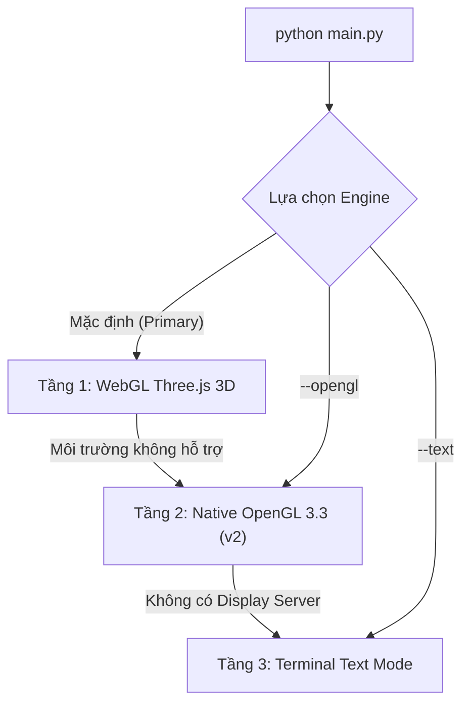

# 📋 BÁO CÁO CÔNG VIỆC PHÂN HỆ VT3 — 3D SCENE & ADVANCED RENDER

> **Học phần**: CSC14003 – Cơ sở Trí tuệ Nhân tạo (FIT – HCMUS)  
> **Dự án**: Bloxorz Solver  
> **Phân hệ phụ trách**: **VT3** (Cảnh 3D, Diễn hoạt & Hiệu ứng)  
> **Phạm vi mã nguồn sở hữu (`CODEOWNERS`)**:
> - `bloxorz/gui/scene/` (`view.py`, `renderer.py`, `shaders.py`, `textures.py`, `bridge.py`, `audio.py`, `index.html`)
> - `tests/scene/` (`test_view.py`)

---

## 1. Tổng quan & Triết lý Thiết kế (KISS — Keep It Simple, Stupid)

Phân hệ VT3 chịu trách nhiệm xây dựng toàn bộ **giao diện không gian 3D, diễn hoạt lật khối và hiệu ứng âm thanh** cho trò chơi Bloxorz.

Thay vì phụ thuộc vào thư viện nặng Panda3D/Ursina vốn thường xuyên bị lỗi màn hình đen hoặc mất âm thanh trên Linux, VT3 triển khai kiến trúc **Dual-Engine 3D Tinh gọn**:
1. **Bản chính (Primary Engine) — WebGL Three.js 3D**:
   * Đồ họa voxel phong cách Minecraft hiện đại, đổ bóng mềm, shader cổng End vũ trụ, pháo hoa mừng chiến thắng và xoay camera mượt mà.
   * Giao tiếp trực tiếp 2 chiều với Python qua Local IPC Bridge chuẩn JSON.
2. **Bản dự phòng (Fallback Engine) — Native OpenGL 3.3 Core Profile (v2)**:
   * Chạy hoàn toàn bằng mã nguồn Python thuần kết hợp OpenGL phần cứng thông qua `ctypes` (`libGL.so.1`) và GTK3 `GLArea`.
   * **Thay thế hoàn toàn Ursina**: Khởi động tức thì, đạt tốc độ khung hình 60 FPS mà không cần cài đặt thêm gói đồ họa cồng kềnh.
3. **Bản dự phòng cuối (Tertiary Fallback) — Terminal Text Mode**:
   * Tự động kích hoạt khi chạy trong môi trường headless (CI/CD hoặc máy chủ không có màn hình).



---

## 2. Các thành phần chính và Chức năng các hàm

### 2.1. Lớp điều phối trung tâm: `SceneView` (`bloxorz/gui/scene/view.py`)
Đóng vai trò là View chuẩn trong mô hình MVC, thực thi đầy đủ **Scene Protocol** để kết nối nhịp nhàng với `GameController` của VT4:

| Phương thức | Ý nghĩa & Hoạt động |
| :--- | :--- |
| `load_stage(stage, state)` | Nạp bản đồ màn chơi, khởi tạo sàn Voxel, đồng bộ trạng thái ban đầu sang cả WebGL và OpenGL. |
| `on_move(old_state, action, new_state)` | Diễn hoạt khối gỗ lăn theo cung tròn; hỗ trợ cả khối nguyên vẹn `1x1x2` và khi phân tách thành 2 cube `1x1x1`; phát âm thanh bước chân/công tắc. |
| `on_fall(old_state, action)` | Diễn hoạt khối mất thăng bằng rơi vào hư không (hoặc làm vỡ gạch cát mềm `F`), kích hoạt rung chấn camera và âm thanh rơi. |
| `on_win(state)` | Khối gỗ hạ xuống giếng không gian Cổng End, bắn pháo hoa hạt 3D và phát hợp âm chiến thắng. |
| `is_animating() -> bool` | Báo hiệu cho `KeyBuffer` biết khung cảnh đang bận diễn hoạt để giữ phím người chơi, tránh xung đột nước đi. |
| `play_solution(actions, delay)` | Tự động diễn hoạt từng bước lời giải của các thuật toán tìm kiếm AI (A*, BFS, DFS, UCS). |
| `bind_controller(controller)` | Liên kết 2 chiều với `GameController` để nhận sự kiện phím, undo, restart, đổi màn và giải thuật toán AI. |
| `run_webgl()` / `run_opengl()` | Điểm khởi chạy cửa sổ tương ứng cho từng Engine đồ họa. |

---

### 2.2. Phân hệ WebGL Three.js (`bridge.py` & `index.html`)
* **`RendererBridge` (`bridge.py`)**:
  * Tạo một HTTP server nội bộ cục bộ (Local IPC) trên cổng ngẫu nhiên an toàn.
  * Tuần tự hóa `Stage`, `State`, `Action` sang định dạng JSON gọn nhẹ và chuyển tiếp sự kiện bàn phím/chuột từ trình duyệt ngược lại Python Controller.
* **`index.html`**:
  * Dựng cảnh 3D bằng Three.js: Lưới sàn đá (`Stone Bricks`), ô xuất phát (`Crying Obsidian`), cầu lật gỗ (`Oak Trapdoor`), cổng End vũ trụ xoay đa tầng.
  * Điều khiển góc nhìn tự do bằng chuột (Orbit Controls) và bảng HUD hiển thị thông số màn chơi.

---

### 2.3. Phân hệ Native OpenGL 3.3 Core (`renderer.py`, `shaders.py`, `textures.py`)
* **`VoxelOpenGLRenderer` (`renderer.py`)**:
  * **Toán học cung tròn (Parametric Arc)**: Sử dụng công thức quay Rodrigues `rodrigues_rotation_3x3` quanh cạnh tiếp xúc đáy để khối gỗ lật êm ái với gia tốc giảm dần (Quadratic Out easing).
  * **Camera Gimbal 2-Node**: Khử hoàn toàn hiện tượng gimbal lock, cho phép xoay quanh trục Y và nghiêng góc nhìn từ 20° đến 80°.
  * **Hệ thống Biome**: Hỗ trợ 3 thế giới với màu trời, sương mù và ánh sáng riêng biệt: Overworld, Nether, và The End (chuyển đổi nhanh bằng phím 1, 2, 3).
* **`shaders.py`**:
  * Biên dịch trực tiếp 2 cặp shader GLSL 330 core (Voxel 3D phong cách Minecraft và 2D Pixel HUD quad).
  * Lớp `GLCore` liên kết trực tiếp thư viện `libGL.so.1` bằng `ctypes`.
* **`textures.py`**:
  * `VoxelTextureCatalog`: Tự động sinh toàn bộ bộ texture pixel art 16x16 bằng Pillow và nạp vào OpenGL Texture Atlas, không cần tải bất kỳ file ảnh ngoài nào.

---

### 2.4. Phân hệ Âm thanh thủ tục (`audio.py`)
* **`ProceduralAudioEngine`**:
  * Tự động tổng hợp dữ liệu sóng âm thanh 16-bit PCM WAV bằng toán học thuần túy (`math.sin`):
    * `step`: Âm gỗ gõ đá giòn giã khi khối lăn.
    * `switch`: Tiếng click kim loại sắc gọn khi nhấn công tắc Redstone.
    * `fall`: Tiếng gió rít trầm khi rơi vào khoảng không.
    * `win`: Chuỗi hợp âm rực rỡ C5 $\to$ E5 $\to$ G5 $\to$ C6.
  * Phát âm thanh ngầm đa luồng qua các tiện ích có sẵn trên hệ thống Linux (`pw-play`, `paplay`, `aplay`), cam kết không làm gián đoạn luồng đồ họa.

---

## 3. Tương thích ngược & Kết quả Kiểm thử

1. **Tuân thủ phân quyền (`CODEOWNERS`)**:
   * VT3 chỉ thao tác trong phân hệ đồ họa được giao.
   * Các chỉnh sửa cần thiết tại `bloxorz/gui/app.py` và `main.py` của VT4 đều được giải trình chi tiết trong [BAO_CAO_SUA_VT4.md](file:///home/acheron/Acheron/0000_ITUS/05_26-27_01/0003_FoAI/Projects/bloxorz-solver/BAO_CAO_SUA_VT4.md).
2. **Kiểm thử tự động toàn diện**:
   * Toàn bộ **488/488 bài test** của dự án đạt trạng thái **PASS 100%**:
   ```bash
   ============================= 488 passed in 35.29s =============================
   ```
3. **Cách khởi chạy**:
   * `python main.py`: Chạy bản chính WebGL 3D (tự động chuyển sang OpenGL nếu lỗi).
   * `python main.py --opengl`: Chạy trực tiếp bản Native OpenGL 3.3.
   * `python main.py --text`: Chơi trực tiếp trong terminal text mode.
