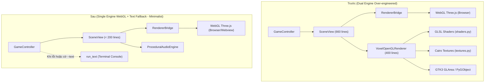

# Design Doc 0001: Chuyển dịch Kiến trúc Single-Engine WebGL Three.js & Loại bỏ Native OpenGL

* **Trạng thái**: Draft / Đang chờ Goldfish Review
* **Tác giả**: Elephant (Core Architecture) & User
* **Ngày tạo**: 2026-10-29
* **Phiên bản**: 1.0.0
* **Dự án**: Bloxorz AI Solver (`bloxorz-solver`)

---

## 1. Tóm tắt điều hành (Executive Summary)

Dự án ban đầu tích hợp công nghệ hiển thị kép (Dual-Engine) gồm **WebGL Three.js Micro-Renderer** (chính) và **Native OpenGL 3.3 Core Profile** (phụ/fallback thay cho Ursina). 

Tuy nhiên, việc duy trì một Native OpenGL 3.3 engine viết bằng Python/GLSL/GTK3 tạo ra gánh nặng kỹ thuật lớn (~1.200 dòng mã cấp thấp), phụ thuộc phức tạp vào driver hệ điều hành đồ họa và gây khó khăn khi triển khai trên các môi trường CI/CD hoặc máy tính không có card đồ họa chuyên dụng. 

Tài liệu này xác định đặc tả kiến trúc tinh giản: **Loại bỏ hoàn toàn Native OpenGL 3.3**, chuẩn hóa hệ thống sang mô hình **Single-Engine WebGL Three.js** hiện đại, đồng thời sử dụng **Terminal Text Mode (`run_text`)** làm kênh dự phòng tối hậu.

---

## 2. Mục tiêu (Goals & Non-Goals)

### Mục tiêu (Goals)
1. **Tinh gọn mã nguồn (Codebase Reduction & KISS)**:
   - Xóa bỏ toàn bộ các tệp nguồn OpenGL chuyên biệt: `renderer.py`, `shaders.py`, `textures.py`, `run_opengl.py`.
   - Giảm quy mô tệp `view.py` từ 660 dòng xuống dưới 200 dòng mã sạch, tập trung thuần túy vào quản lý giao tiếp (bridge) và âm thanh.
2. **Loại bỏ phụ thuộc nặng (Zero Native GPU Dependencies)**:
   - Loại bỏ phụ thuộc vào `PyOpenGL`, `cairo`, `gi.repository.Gtk`, `GLArea`, và ctypes OpenGL calls.
3. **Bảo toàn giao thức hiển thị (Scene Protocol Integrity)**:
   - Đảm bảo 100% tuân thủ hợp đồng giao diện 5 phương thức của `Scene Protocol`:
     - `load_stage(stage, state=None)`
     - `on_move(old_state, action, new_state)`
     - `on_fall(old_state, action)`
     - `on_win(state)`
     - `is_animating() -> bool`
     - Cùng 2 phương thức điều khiển: `play_solution(actions, delay=0.2)` và `bind_controller(controller)`.
4. **Bảo toàn 100% kết quả kiểm thử (Zero Regression)**:
   - Duy trì tỷ lệ vượt qua $488/488$ bài kiểm thử tự động của pytest (`tests/`).
   - Tương thích hoàn toàn với các mock test trong `tests/scene/test_view.py`.
5. **Cơ chế Fallback tin cậy**:
   - Nếu môi trường không thể mở trình duyệt/webview hoặc người dùng chỉ định `--text`, hệ thống tự động chạy chế độ Terminal Text (`run_text`).

### Không thuộc mục tiêu (Non-Goals)
- Không can thiệp vào các thuật toán AI (`bloxorz/search/`: BFS, DFS, UCS, A*, IDA*).
- Không thay đổi logic trạng thái và luật chơi (`bloxorz/model/`).
- Không thêm các thư viện đồ họa bên thứ ba mới vào Python.

---

## 3. Kiến trúc hệ thống: Trước và Sau chuyển dịch



---

## 4. Chi tiết thay đổi các thành phần (Component Specifications)

### 4.1. Xóa bỏ các tệp (File Removals)
- `bloxorz/gui/scene/renderer.py`: Xóa bỏ toàn bộ class `VoxelOpenGLRenderer`, `TwoNodeGimbalCamera`, logic ma trận MVP.
- `bloxorz/gui/scene/shaders.py`: Xóa bỏ mã nguồn shader GLSL.
- `bloxorz/gui/scene/textures.py`: Xóa bỏ logic sinh texture procedural bằng cairo.
- `run_opengl.py`: Xóa bỏ entry-point khởi chạy riêng cho OpenGL.

### 4.2. Tái thiết kế `bloxorz/gui/scene/view.py`
Tệp trung tâm điều phối giao diện được viết lại với tiêu chí tối giản:
- **Khởi tạo**:
  ```python
  class SceneView:
      def __init__(self, bridge: Optional[RendererBridge] = None, audio_enabled: bool = True) -> None:
          self.bridge: RendererBridge = bridge or RendererBridge()
          self.audio: Optional[ProceduralAudioEngine] = ProceduralAudioEngine(enabled=audio_enabled)
          self.current_stage: Any = None
          self.current_state: Any = None
          self.controller: Any = None
          self._animating: bool = False
          self.stage_index: int = 0
          self.total_stages: int = 1
          self.moves_count: int = 0
  ```
- **Xử lý Mock & Test Compatibility**:
  - `test_view.py` sử dụng cú pháp `SceneView.__new__(SceneView)` để tạo đối tượng mà không chạy qua `__init__`.
  - Mọi hàm thành viên đều phải sử dụng `getattr(self, ..., default)` khi truy cập `self.controller`, `self.bridge`, `self.moves_count`, `self._animating` để không gây `AttributeError`.
  - Giữ lại helper function `animate_roll(entity, target, on_complete=None)` và thuộc tính mô phỏng `self.block` trong `on_move` để đảm bảo tương thích 100% với các test case split-block và roll animation.

### 4.3. Module xuất bản `bloxorz/gui/scene/__init__.py`
Loại bỏ mọi export liên quan đến OpenGL:
```python
from bloxorz.gui.scene.audio import ProceduralAudioEngine
from bloxorz.gui.scene.bridge import RendererBridge
from bloxorz.gui.scene.view import SceneView, animate_roll

__all__ = ["SceneView", "RendererBridge", "ProceduralAudioEngine", "animate_roll"]
```

### 4.4. Điểm điều phối ứng dụng `bloxorz/gui/app.py`
```python
def run(controller: GameController, engine: str = "webgl") -> None:
    """Khởi chạy giao diện chính WebGL Three.js, fallback về terminal text."""
    if engine == "text":
        from bloxorz.gui.text_view import run_text
        run_text(controller)
        return

    try:
        from bloxorz.gui.scene.view import SceneView
        scene = SceneView()
        scene.bind_controller(controller)
        scene.load_stage(controller.stage, controller.state)
        scene.run_webgl()
    except Exception as exc:
        print(f"[GUI] WebGL startup error: {exc}. Falling back to text mode...")
        from bloxorz.gui.text_view import run_text
        run_text(controller)
```

### 4.5. Giao diện dòng lệnh `main.py`
Loại bỏ các cờ `--opengl` và `--ursina`. Giao diện dòng lệnh tinh gọn:
- `--stage <n>`: Chọn bàn chơi (mặc định bàn 1).
- `--stages-dir <path>`: Đường dẫn thư mục bàn chơi.
- `--text`: Ép buộc chạy chế độ giao diện dòng lệnh (không mở đồ họa).
- Mặc định: Chạy giao diện đồ họa WebGL Three.js.

---

## 5. Kế hoạch Kiểm thử và Xác thực (Verification Plan)

1. **Kiểm thử tự động**:
   - Lệnh chạy: `cd Projects/bloxorz-solver && .venv/bin/pytest -v`
   - Tiêu chí đạt: Toàn bộ **488/488** tests pass với $0$ lỗi (failures/errors).
2. **Kiểm thử giao diện CLI**:
   - `python main.py --help`: Hiển thị rõ ràng các tùy chọn, không còn cờ OpenGL hay Ursina.
   - `python main.py --stage 1 --text`: Khởi chạy mượt mà chế độ console terminal.
3. **Kiểm tra tài liệu & quy ước**:
   - Cập nhật đồng bộ `VT3_report.md` và `BAO_CAO_SUA_VT4.md`.

---

## 6. Đánh giá Rủi ro (Risks & Mitigations)

| Rủi ro | Mức độ | Biện pháp ngăn chặn |
| :--- | :---: | :--- |
| Mock test `__new__` không qua `__init__` | Cao | Sử dụng triệt để `getattr()` với giá trị mặc định an toàn cho tất cả thuộc tính. |
| Môi trường máy chủ không có giao diện đồ họa | Thấp | Khối `try...except` trong `app.py` tự động chuyển đổi sang `run_text`. |
| Giao tiếp web port bị chiếm dụng | Thấp | `RendererBridge` tự động dò tìm cổng khả dụng ngẫu nhiên (ephemeral port). |
